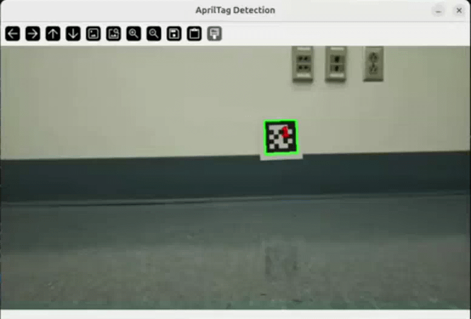
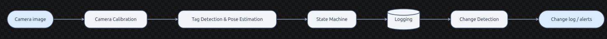
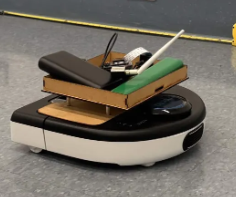
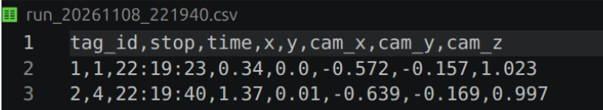
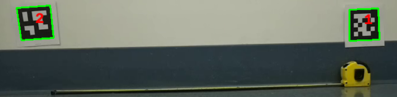

# Machine Vision: Neato Warehouse

**Computational Introduction to Robotics, Project 3**

Thanadetch (Detch) Mateedunsatits ([dmateedunsatits@olin.edu](mailto:dmateedunsatits@olin.edu)) and Ophelia Lonzo ([olonzo@olin.edu](mailto:olonzo@olin.edu))

November 9, 2026



## 1. Project Overview

Warehouses need to know what products are where, and when they move. This is usually done by workers walking the aisles with handheld scanners, which is slow, repetitive and can lead to errors. Robots that can do this job for us by navigating aisles and taking inventory on their own are a  common answer to this problem. For our machine vision project, we built a simple version of this idea. We set up a "mini warehouse" containing AprilTags, black-and-white square markers similar to QR code, designed specifically for use by robots. Unlike a QR code, an AprilTag is built to be detected quickly from a distance and from many angles, and it lets the robot determine the position of the tag in space, not just what it says.

We used the Neato, equipped with a Raspberry Pi camera, as our robot. Every time it sees a tag, it records the tag's ID (what item or shelf it is), a timestamp (when it was seen), and a location (where it was seen). For our Minimum Viable Product (MVP), the Neato drives a predetermined route and creates a text log of the tags. For our stretch goal, we wanted an algorithm that compares runs to see what has changed in the warehouse.

The final system drives a Neato along a fixed route past a row of tagged shelves, writes a log with one entry per tag, and can compare two logs to report which items are new, missing, or moved.

### Learning Goals

- **Team:** Our learning goals as a team were to advance our knowledge of computer vision and apply it to other robotics areas.
- **Ophelia:** For this project, I wanted to use AprilTags to learn how to use computer vision while eliminating some of the more finicky aspects of it.
- **Detch** : For this project, I wanted to test out using computer vision to track items, potentially using it to track batteries and logging inventory (lead-acid car batteries) for my family business backhome in Thailand.
 
## 2. How It Works

Our system turns a camera image into a log of what is on the shelves. The pipeline has six steps: **Camera → Camera Calibration → Tag Detection and Pose Estimation → State Machine → Logging → Change Detection.**


### Camera Calibration

Camera lenses distort images slightly, which would cause the pose estimation from AprilTags to be incorrect. To correct this distortion, we need to find how the camera distorts the image. We used a printed checkerboard and the ROS camera calibrator node (`cameracalibrator`) to calibrate the Neato's camera, following the [ROS Monocular Calibration tutorial](https://wiki.ros.org/camera_calibration/Tutorials/MonocularCalibration). The node computed the camera's intrinsic matrix and distortion coefficients, which we saved to `calibration_data.yaml` for the rest of the pipeline to use.

### AprilTag Detection and Pose Estimation

We used the [pupil-apriltags](https://github.com/pupil-labs/apriltags) library with the `tag25h9` family. For each frame, we convert the image to grayscale and remove lens distortion using OpenCV's `undistort` function, with the camera matrix and distortion coefficients from calibration. The detector then finds each tag, reads its ID, and finds its four corners. We also give the function the camera's focal lengths and optical center and the tag's real side length (0.107 m), so it can solve for the tag's 3D pose relative to the camera. This gives a translation vector in meters: x to the side, y up or down, and z forward along the camera's view. We log this as `cam_x`, `cam_y`, and `cam_z`.

### State Machine

The robot runs a finite state machine with four states:

| State | What the robot does |
|---|---|
| `drive` | Moves forward at 0.08 m/s until odometry shows it has gone 0.30 m since the last stop. |
| `scan_wait` | Stops for one second so the camera image settles. |
| `scan` | Collects 8 camera frames and records every tag it sees. It then logs any tags it has not recorded before and returns to `drive`. |
| `done` | After five stops, writes the log to a time-stamped CSV and exits. |

During this process, the Neato's lidar scans, and if anything is closer than 0.20 m ahead, the robot stops early,  scans once more, and ends the run if the path is still blocked.

### Logging and Duplicate Filtering

Once the robot has logged a tag, it ignores any later detections with the same ID. This keeps the log to one entry per tag, even though the same tag is seen in many frames and can be visible from consecutive stops. This is to stop many detections of the same tag to be entered into the log.  Each entry contains the tag ID, the stop number, a timestamp, the robot's odometry position, and the tag's position relative to the camera.

### Change Detection

To compare two runs, we match tags by ID and record which stop each one was seen at. Because the robot scans at fixed intervals along the same route, the stop number can tell us where a tag is. A tag that appears only in the new run is shown as **NEW**, a tag that appears only in the old run is **MISSING**, and a tag in both runs whose stop number changed is **MOVED**. This lets us see what has changed in our "warehouse" and where things have moved.

## 3. Design Decisions

**Duplicate detections.** A camera will see the same tag many times, and each sighting gives a slightly different position estimate because of image noise and odometry error. A logger with no duplicate filter would write many entries for a single tag. We needed to decide when a detection should be logged, and we decided to save only the first sighting of each tag into our log.

**Fixed route.** We considered having the robot use the tags and its lidar to navigate, but chose to have it drive a straight, fixed route. This was due to time constraints and because we wanted to focus more on refining the detection of tags. We used the lidar as a simple saftey stop, as this would be easy to add on to if we created a more advanced navigation system for the robot.

**Log format.** The log is a CSV with one row per tag:

```
tag_id, stop, time, x, y, cam_x, cam_y, cam_z
```

`x` and `y` are the robot's odometry position at the stop, and the `cam_` fields are the tag's position relative to the camera. A CSV is easy to open in a spreadsheet and easy to compare across runs.

## 4. Challenges

One challenge we faced was the position of the camera on the Neato. The Neato originally had the camera mounted facing forward, which is very useful for obstacle avoidance and most applications of machine vision on a Neato. This orientation was not very useful in our case, though, as the Neato can only move in the direction it is facing. To solve this, we created a device to hold the camera and have it point to the side of the Neato instead. This was very useful for scanning a long row of AprilTags.

 

## 5. Results

We succeeded in creating a program that has a Neato drive down a designated line, scan several AprilTags, and log them. We also created a program that compares two logs against each other to see what has changed and what has moved. Below is a link to a video of one of our successful runs.

[Video of a successful run](https://www.youtube.com/watch?v=WxRx6BszBT0&t=12s)

The accuracy of our pose estimation turned out pretty good. As seen below we measured the length between the centers of 2 AprilTags and found that they were about 100 cm apart.  The log shows the tags to be 96 cm apart. This is pretty good accuracy.




## 6. Future Improvements

With more time, we would focus on making the robot more autonomous, more accurate, and more useful to the person reading its output. One example of what what we would add is Tag based navigation. Right now, the robot follows a fixed route. A more advanced version could use the tags to determine where both the tag and the robot are, add obstacle avoidance, and navigate on its own to specific tags. We would also add better duplicate handling. Our current solution that only uses the first detection works, but there are better solutions. We could continuously save each reading and average the results, which would give a more accurate pose estimate because multiple readings make up for noise. Our code already collects 8 frames per stop, so this would be a small change. We could also improve outr change detection. We log each tag's position relative to the camera but do not yet use it for comparison. A better version would convert each tag to a fixed warehouse coordinate and flag a tag as moved only when it shifts by more than a distance threshold.

## 7. Lessons Learned

One lesson we learned from this project is that AprilTags are very useful for many different applications. The ability to read a tag ID and get an accurate position of the tag is useful not just for warehouse logging, but also for things like navigating where GPS cannot reach, or navigating underwater.

We also learned how important camera calibration is when dealing with computer vision. If we had not calibrated our camera before testing, we would have had wildly inaccurate results.

## 8. Relation to Real-World Robotics Systems

Our project is a miniature version of a system that companies already build and sell. This is a mobile robot that patrols a space, perceives what is there, and communicated what it sees. Companies such as Simbe Robotics build robots for retail stores that scan shelves to track stock, and similar products exist for warehouses, including drones that fly through aisles reading labels on pallets. Our robot follows the same basic loop as many of these. It perceives items with cameras, finds where each item is, records it, and compares against earlier scans to find what is missing or out of place. Our change detection step is a simplified version of these algorithms.

Fiducial markers are also common in industry. AprilTags and similar markers are widely used in robotics because they make perception reliable and cheap. Warehouse robot fleets, most famously Amazon's drive units, have used printed codes on the floor to help robots know where they are.

## 9. How to Use

**Requirements:** ROS 2, `pupil-apriltags`, `opencv-python`, `cv_bridge`, `numpy`, `pyyaml`

**Run a patrol:**

```bash
ros2 run logger tag_logger
```

The log is saved as `run_YYYYMMDD_HHMMSS.csv` in the directory where you launched the node.

**Compare two runs:** run two patrols to get two CSVs (for example, `run_20261109_153000.csv` and `run_20261109_154500.csv`), then run the following from the folder that contains both files:

```bash
python3 compare_runs.py run_A.csv run_B.csv
```
